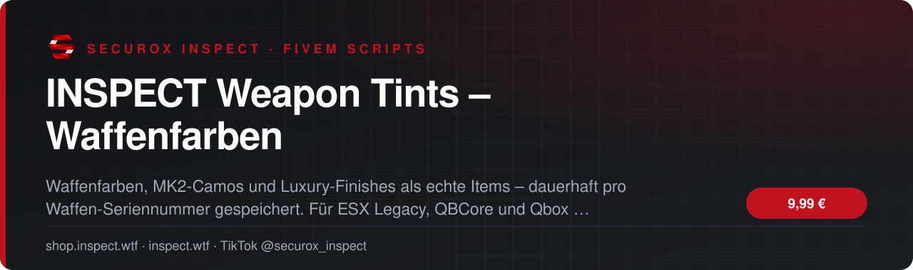
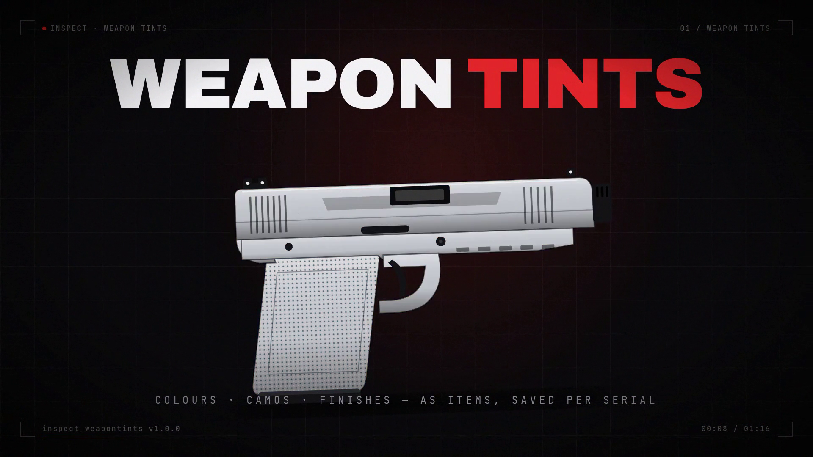

<!-- inspect-showcase: automatisch erzeugt, Änderungen bitte im Shop vornehmen -->

  
  
  
  
  

  
  
  

 

> 🇬🇧 **English:** INSPECT Weapon Tints – Waffenfarben – FiveM script (ESX, QBCore, Qbox) by SecuroX Inspect. Purchase and licensing exclusively at [shop.inspect.wtf](https://shop.inspect.wtf). Product details below are in German – questions are welcome on [Discord](https://discord.gg/inspect).

 

## Das Wichtigste auf einen Blick

<table>
  <tr>
    <td width="50%" valign="top">✔&nbsp; <b>Kompatibilität · ESX Legacy, QBCore und Qbox</b></td>
    <td width="50%" valign="top">✔&nbsp; <b>Kompatibilität · Inventare: ox_inventory, jaksam_inventory, qb-inventory, ps-inventory, lj-inventory und qs-inventory – automatisch erkannt</b></td>
  </tr>
  <tr>
    <td width="50%" valign="top">✔&nbsp; <b>Kompatibilität · Datenbank: oxmysql</b></td>
    <td width="50%" valign="top">✔&nbsp; <b>Waffen · Funktioniert mit jeder Vanilla-Waffe – Farben werden live geprüft, keine Waffenliste nötig</b></td>
  </tr>
</table>

## Überblick

Jede Waffe. Jede Farbe.

INSPECT Weapon Tints bringt Waffenfarben, MK2-Camos und exklusive Luxury-, Lowrider- und VIP-Finishes als echte Items auf deinen FiveM-Server. Der gewählte Look wird pro Waffen-Seriennummer gespeichert und bleibt dadurch auch nach Server-Restarts oder einem Besitzerwechsel erhalten.

Keine Waffenlisten pflegen  
Das System prüft live, welche Vanilla-Waffen eine Farbe oder ein Finish unterstützen. Normale Waffen und MK2-Waffen werden automatisch korrekt behandelt – ohne manuell gepflegte Waffenlisten.

Farben, Camos und Finishes als echte Items  
Enthalten sind 8 Farb-Items für normale und MK2-Waffen, 11 MK2-Camos für alle 12 MK2-Waffen inklusive Schlitten-Camo sowie Luxury-, Lowrider- und VIP-Finishes für alle 22 Waffen, die ein solches Finish unterstützen.

Dauerhaft pro Seriennummer gespeichert  
Der Look bleibt direkt an der jeweiligen Waffe. Wird sie weitergegeben oder nach einem Restart erneut geladen, wird die gespeicherte Optik automatisch wieder angewendet.

Keine verschwendeten Items  
Passt eine Farbe oder ein Finish nicht zur ausgewählten Waffe, wird das Item nicht verbraucht. Mit /tintclear kann der aktive Look entfernt und das entsprechende Item zurückgegeben werden.

Sicher und integrationsfreundlich  
Alle wichtigen Vorgänge werden serverseitig validiert und durch einen Cooldown abgesichert. Framework und unterstützte Inventare werden automatisch erkannt. Config, Bridge und Übersetzungen bleiben offen editierbar.

Schnell installiert  
20 Item-Bilder, deutsche und englische Übersetzungen sowie offene Config-, Bridge- und Locale-Dateien sind enthalten.

## Kompatibilität

| | |
|:--|:--|
| Frameworks | **ESX** · **QBCore** · **Qbox** |
| Unterstützte Ressourcen | `ox_inventory` |
| Plattform | FiveM (GTA V) |

## Alle weiteren Funktionen

- Farben · 8 Farb-Items für normale und MK2-Waffen
- MK2 · 11 MK2-Camos für alle 12 MK2-Waffen inklusive Schlitten-Camo
- Finishes · Luxury-, Lowrider- und VIP-Finishes für alle 22 unterstützten Waffen
- Persistenz · Speicherung pro Waffen-Seriennummer
- Persistenz · Look bleibt nach Server-Restarts und Besitzerwechseln erhalten
- Persistenz · Automatische Wiederherstellung, wenn das Inventar die Waffe neu ausgibt
- Items · Nicht kompatible Farben verbrauchen das Item nicht
- Items · /tintclear entfernt den Look und gibt das Item zurück
- Sicherheit · Serverseitige Validierung mit Cooldown
- Installation · 20 Item-Bilder inklusive

<b>3 weitere Funktionen anzeigen</b>

- Entwickler · Offene Config, Bridge und Locales
- Sprache · Deutsch und Englisch
- Support · discord.gg/inspect

## Preis

**9,99 €** &nbsp;–&nbsp; einmaliger Kaufpreis · Download und Lizenz im Kundenkonto

Sichere Zahlung mit PayPal oder Kreditkarte · Rechnung als PDF · Support auf Deutsch

## So einfach geht's

1. **Im Shop kaufen** – sicher bezahlen mit PayPal oder Kreditkarte.
2. **Sofort loslegen** – Download und Lizenz stehen direkt nach Zahlungseingang in deinem Kundenkonto bereit, die Rechnung erhältst du als PDF.
3. **Einrichten** – bei Fragen hilft dir unser Support im Discord weiter.

## Warum INSPECT?

<table>
  <tr>
    <td width="50%" valign="top"><b>🇩🇪 Entwickelt in Deutschland</b> Konzeption, Entwicklung und Support aus einer Hand.</td>
    <td width="50%" valign="top"><b>💬 Persönlicher Support</b> Schnelle Hilfe auf Deutsch im INSPECT Discord.</td>
  </tr>
  <tr>
    <td width="50%" valign="top"><b>🔒 Sichere Zahlung</b> PayPal oder Kreditkarte, Rechnung automatisch als PDF.</td>
    <td width="50%" valign="top"><b>⚡ Sofort verfügbar</b> Download und Lizenz direkt nach der Zahlung im Kundenkonto.</td>
  </tr>
</table>

## Häufige Fragen

<b>Wie erhalte ich das Produkt?</b>

 

Nach bestätigter Zahlung stehen Download und Lizenz in deinem Kundenkonto bereit. Die Rechnung erhältst du als PDF.

<b>Welche Frameworks werden unterstützt?</b>

 

ESX, QBCore, Qbox – zusätzlich mit Unterstützung für ox_inventory.

<b>Bekomme ich Hilfe bei der Einrichtung?</b>

 

Ja – unser Support hilft dir im [INSPECT Discord](https://discord.gg/inspect) persönlich und auf Deutsch.

<b>Wo kaufe ich offiziell?</b>

 

Ausschließlich im INSPECT Shop unter [shop.inspect.wtf](https://shop.inspect.wtf). Angebote von Dritten stammen nicht von uns.

## Kontakt

| | |
|:--|:--|
| 🛒 Shop | [shop.inspect.wtf](https://shop.inspect.wtf) |
| 🌐 Website | [inspect.wtf](https://inspect.wtf) |
| 💬 Discord | [discord.gg/inspect](https://discord.gg/inspect) |
| 🎬 TikTok | [@securox_inspect](https://www.tiktok.com/@securox_inspect) |
| ✉️ E-Mail | [info@inspect.wtf](mailto:info@inspect.wtf) |

---

<b>SecuroX Inspect</b> · Offizielle Produktpräsentation · Dieses Repository enthält keinen Quellcode und keine Produktdateien. 
Kauf und Lizenzen ausschließlich über <a href="https://shop.inspect.wtf">shop.inspect.wtf</a> · Inhalte werden automatisch aus dem Shop aktualisiert.

